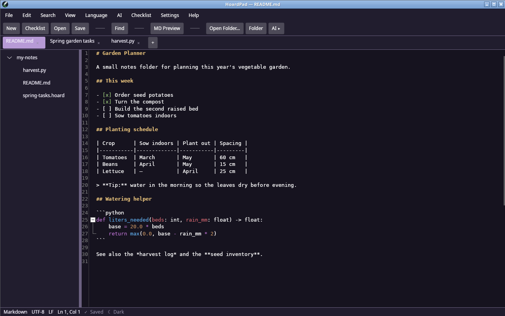
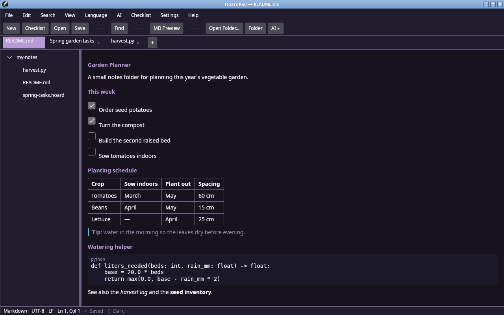
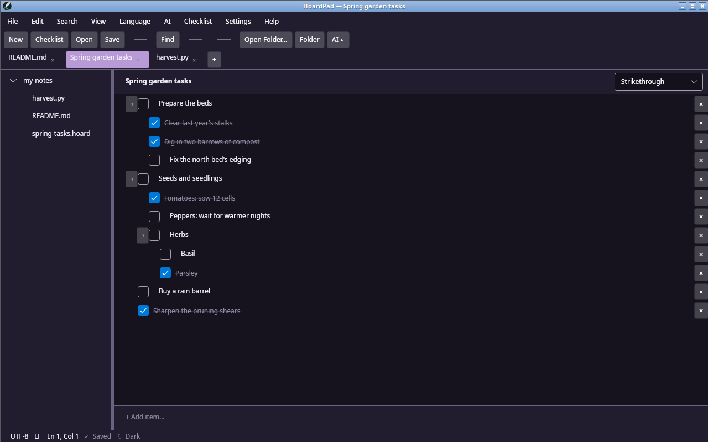
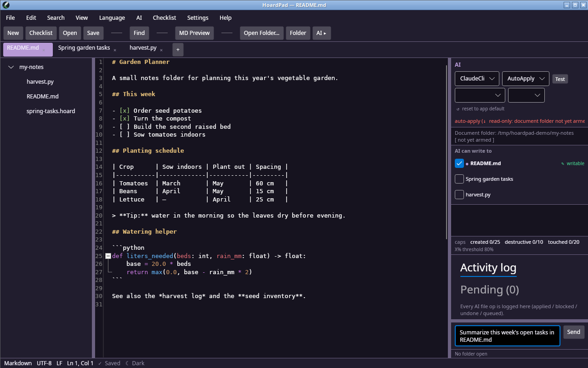

# HoardPad

[](LICENSE)
[](https://github.com/builtwithclaudetech/hoardpad/actions/workflows/ci.yml)


HoardPad is a lightweight, cross-platform text and code editor in the
Notepad++ tradition. It is written in C# on
[Avalonia](https://avaloniaui.net/) and
[AvaloniaEdit](https://github.com/AvaloniaUI/AvaloniaEdit). On top of the
usual tabbed editing, it adds three things:

- **Markdown with a rendered preview.** Colorized source, plus a read-only
  rendered view that you toggle with one key.
- **A native `.hoard` checklist document type.** Nested items, three display
  modes for checked items, and every change saved to disk immediately.
- **An agentic AI panel** that can read and act on your open documents and
  the open folder, with its file writes confined to a sandbox.

**Audience:** developers and power users who want a small, fast editor with
an AI assistant whose file access is limited by construction. If you want to
understand or contribute to the design, start with
[Documentation](#documentation).

## Screenshots

Colorized Markdown source, with the folder tree and tabs:



The same file with the rendered preview toggled on (Ctrl+Shift+V):



A nested `.hoard` checklist in strikethrough mode:



The AI panel, before the first request arms write access for the folder:



## Features

### Editor

- Tabs with drag-to-reorder, a folder tree, and session restore. Open tabs,
  unsaved scratch buffers, unsaved edits, the active tab, cursor positions,
  and the open folder all come back after a restart.
- Syntax highlighting with TextMate grammars (the same grammar format VS Code
  uses) for 20 languages: Markdown, HTML, JavaScript, CSS, Python, C#, XML,
  JSON, SQL, Rust, TypeScript, YAML, TOML, Shell/Bash, PowerShell, Dockerfile,
  C, C++, Java, and Go.
- Code folding, by braces and by indentation.
- Find and Replace with literal or regular-expression matching (.NET regular
  expressions, including capture-group backreferences), case and whole-word
  toggles, and three scopes: the current file, all open files, and the open
  folder.
- Encoding detection on open. HoardPad preserves the original encoding and
  byte-order mark on save and lets you reinterpret a file in another
  encoding.
- Move and duplicate lines, auto-save, dark and light themes, and
  configurable fonts.

### Markdown

- Colorized Markdown source.
- A read-only rendered preview, toggled with Ctrl+Shift+V. It supports
  CommonMark plus tables, task lists, footnotes, autolinks, and strikethrough,
  parsed with [Markdig](https://github.com/xoofx/markdig).
- The preview is a native Avalonia control tree, not a web view. It never
  changes your text, so toggling back gives you a byte-identical buffer.

### `.hoard` checklists

- A native document type for checklists, stored as human-readable JSON
  (`schemaVersion` 2).
- Up to three levels of nesting, with collapse and expand. Indent and outdent
  with Alt+Shift+Right and Alt+Shift+Left. A subtree moves with its parent.
- Three display modes for checked items: strikethrough in place, move to the
  bottom, or hide.
- Checking a parent marks the whole block done and locks its children, which
  keep their own marks. Unchecking the parent restores them.
- Item order, text, check state, and collapse state are written to disk
  atomically on every change, so a crash or kill does not lose list state.

### AI panel

- An in-window panel. Open it from the **AI** menu (Toggle AI Panel) or the
  **AI ▸** toolbar button. It can read the current document, all open
  documents, and the open folder. The agent has three tools, `Read`, `Edit`,
  and `Write`, so it can create files and edit existing files inside that
  folder. It cannot copy, move, rename, or delete files.
- **Backend.** Claude Code in headless mode (`claude -p`) is the default and
  the only backend with a working transport in 1.0.0. See
  [AI backends](#ai-backends) for the Anthropic API and local LLM options.
- **Sandbox.** AI file operations are confined to the open-folder root. A write
  outside it is refused and shown as blocked in the panel. See
  [Safety model](#safety-model).
- **Operations are shown in the panel, but mostly not undoable.** The panel
  shows each file operation the agent attempts as it happens, marked applied
  or blocked. That view lasts for the session. HoardPad does **not** write
  live AI file operations to an on-disk undo journal or activity log in 1.0.0.
  If the AI edits a document that is open in a tab, the edit goes into the
  editor buffer and you can revert it with Ctrl+Z. HoardPad cannot undo files
  the AI created, or edits to files that are not open in a tab. See
  [Known limitations](#known-limitations).
- **Agency modes:** `auto-apply` (default), `approve-each`, and `read-only`.
- **Prompt-injection scrubbing** of re-injected conversation text and of
  settings-change blocks in AI replies, using
  [DragonScrub](https://github.com/builtwithclaudetech/dragonscrub).
- **No telemetry.** HoardPad makes no network calls of its own. The only
  outbound traffic is whatever your configured AI backend does.

## Platform status

| Platform | Status |
|---|---|
| **Linux x64** | Primary platform. Built, tested, and verified by driving the published binary on a live display. |
| **Windows x64** | Builds are provided, and the code compiles for Windows. It has had **far less runtime testing**. |

The design record lists the Windows runtime checks as deferred, not passed:
the AI safety hook firing on Windows, the Job Object process-tree kill, the
write-through durability path for the first write of a file, Windows owner-only
file permissions, and Windows start-up performance. See PRD §5
([SC-8](docs/design-record/prd.md)), technical design
[§4.8 and §6.1](docs/design-record/tech-design.md), and architecture
[§4.7 and §7.6](docs/design-record/architecture.md). If you run HoardPad on
Windows, please report what you find.

## Install

### Prebuilt downloads

Download a zip from the
[Releases page](https://github.com/builtwithclaudetech/hoardpad/releases):

- `HoardPad-<version>-linux-x64.zip`
- `HoardPad-<version>-win-x64.zip`

Builds are self-contained. You do not need to install .NET to run them.
Builds are not code-signed, so Windows SmartScreen may warn you.

### Prerequisites

| Need | For |
|---|---|
| .NET 8 SDK (`global.json` pins 8.0.0, rolling forward to the latest 8.0.x) | Building from source only. |
| **Python 3** on `PATH` | The bundled safety hook, `hooks/deny_by_default.py`. HoardPad runs it as `python3` (Linux) or `python` / `py` (Windows). On Windows it must be Python 3.12 or later. Without Python, AI write access stays off. |
| [Claude Code CLI](https://docs.anthropic.com/en/docs/claude-code) on `PATH`, signed in | The default AI backend. Optional if you do not use the AI panel. |
| `setsid` (from util-linux) at `/usr/bin/setsid` | Linux only. HoardPad uses it to stop the whole AI process tree. It is present on most distributions. |

## Build, test, and run from source

```bash
dotnet restore
dotnet build HoardPad.sln
dotnet test HoardPad.sln
dotnet run --project src/HoardPad.App
```

Some tests run the bundled Python hook, so Python 3 must be on `PATH` when you
run `dotnet test`.

**Build telemetry.** Avalonia's build tooling package, `Avalonia.BuildServices`,
is in the restore graph. During a build it sends anonymized build data to the
Avalonia project, including a hashed project name, target framework, runtime
identifier, Avalonia version, a machine identifier, OS version, and whether the
build runs in CI. To opt out, set the environment variable
`AVALONIA_TELEMETRY_OPTOUT=1` before you build. This happens at build time
only. The HoardPad application itself makes no network calls except to the AI
backend you configure. For details, see the
[Avalonia.BuildServices repository](https://github.com/AvaloniaUI/Avalonia.BuildServices).

### Publish a self-contained build

```bash
dotnet publish src/HoardPad.App/HoardPad.App.csproj -c Release -r linux-x64 --self-contained true -p:PublishReadyToRun=true
dotnet publish src/HoardPad.App/HoardPad.App.csproj -c Release -r win-x64 --self-contained true -p:PublishReadyToRun=true
```

`PublishReadyToRun=true` is required. A publish for a runtime identifier
without it fails on purpose, because start-up time misses its target without
ReadyToRun compilation. Output goes to
`src/HoardPad.App/bin/Release/net8.0/<rid>/publish/`. Delete that folder before
you publish again, because a stale publish can leave mismatched files behind.

> **Windows builds: use `dotnet publish`, not `dotnet build -r win-x64`.**
> `dotnet build -r win-x64` fails with **NETSDK1150**. `HoardPad.App`
> references a helper executable, `HoardPad.SelfTestStandIn`, that is not
> self-contained, and a RID-specific build cannot reference it. Passing
> `--self-contained true` to `dotnet publish` avoids the problem.

### DragonScrub package source

[DragonScrub](https://github.com/builtwithclaudetech/dragonscrub) is not on
nuget.org. This repository vendors the 0.2.0 package in `packages/` and
`NuGet.config` points a local package source at that folder, so
`dotnet restore` works without any extra setup.

## AI backends

Settings offers three backend choices. The table shows what each one does in
1.0.0.

| Backend | Settings value | Status in 1.0.0 |
|---|---|---|
| Claude Code headless (`claude -p`) | `claude-cli` (default) | **Working.** HoardPad launches the `claude` CLI per turn, gates every tool call with the safety hook, and stops the whole process tree on cancel. |
| Anthropic API, direct | `anthropic-api` | **Not connected yet.** The setting, the API key and model fields, and the shared file-operation and tool-call logic exist. There is no network transport, so a turn does not call the API. |
| Local LLM (Ollama or LiteLLM) | `local` | **Not connected yet.** Same status as above. The endpoint and model fields are saved but unused. |

In 1.0.0 every AI turn runs through the Claude Code CLI, whichever backend
you select. The selection does not change which backend runs. Treat the API and local options as groundwork. See the
architecture document for the two-backend design.

Configuration details are in [`PLACEHOLDERS.md`](PLACEHOLDERS.md).

## Safety model

The AI can only touch what you let it, and the controls are enforced in
code, not by asking the model to behave. The short version:

- **Sandbox.** Every AI write is resolved to a real path and checked against
  the open-folder root. Paths that escape through `..`, absolute paths, or
  symlinks are refused. The one exception is a document outside the folder
  that you include in the AI panel: the AI can write to that exact file and
  nothing else. The sandbox limits writes. The agent's read tool is not
  limited to the folder.
- **Deny by default.** The agent is launched with only `Read`, `Edit`, and
  `Write`, and a hook denies every other tool and every out-of-sandbox write.
- **Fail closed.** HoardPad turns on AI write access only after a start-up
  self-test shows the hook blocks an out-of-sandbox write. If anything is
  missing or unclear, the panel is read-only.
- **Caps.** Per turn, the hook allows at most 25 created files, 10
  destructive changes, and 20 distinct files. These are fixed in 1.0.0. The
  cap fields in Settings change only the panel's cap meter, not what the hook
  enforces.
- **Large folders.** If you open your home folder or a folder with more than
  2,000 files, HoardPad switches `auto-apply` to `approve-each`.
- **Visibility, not undo.** The panel shows each operation the agent
  attempts (applied or blocked). Live AI writes are not journaled to disk and
  HoardPad cannot undo them, except through Ctrl+Z for an edit to a document
  that is open in a tab.

For what the sandbox does and does not defend against, read
[`docs/ARCHITECTURE.md`](docs/ARCHITECTURE.md) and [`SECURITY.md`](SECURITY.md).

## Project layout

| Project | Role |
|---|---|
| `src/HoardPad.Core` | Domain kernel: the sandbox containment check, record models, session and recovery logic, undo decisions, and the interfaces (seams) the host implements. No platform dependencies. |
| `src/HoardPad.Core.Ai` | AI logic: per-turn cap accounting, the shared file-operation service, the `claude -p` launch contract, liveness matching, and the tool-call loop logic. No platform dependencies. |
| `src/HoardPad.Core.Checklist` | The `.hoard` model, loader, deterministic serializer, hierarchy, and display-mode logic. No platform dependencies. |
| `src/HoardPad.Host` | The only project with operating-system code: atomic file writes, path resolution, process launch and tree kill, the hook host and observation channel, app-data paths, encoding detection. |
| `src/HoardPad.App` | The Avalonia application: UI, view models, composition root. The only project that references Avalonia. |
| `src/HoardPad.SelfTestStandIn` | A small helper executable that the start-up self-test launches in place of the real `claude` CLI. |
| `tests/` | Unit and headless-UI tests for each product project. |
| `harness/HoardPad.Bench` | Start-up and warm-open timing launcher for a published build. |
| `harness/HoardPad.AcceptanceHarness` | The AI-safety acceptance gate. It drives the real hook and the shared file-operation service. |
| `hooks/deny_by_default.py` | The PreToolUse safety hook, bundled next to the published app. |

## Known limitations

- Only the Claude Code backend works in 1.0.0 (see [AI backends](#ai-backends)).
- Live AI file operations are not journaled to disk and cannot be undone,
  except through editor undo (Ctrl+Z) for a document that is open in a tab.
  Files the AI creates, and edits to files not open in a tab, are not
  reversible by HoardPad. The on-disk undo journal and activity log exist in
  the code but are written only when you re-apply a parked or approved
  operation.
- The Settings cap fields (create, destructive, distinct files, magnitude
  percent) change only the panel's cap meter. The hook enforces the fixed
  defaults of 25, 10, 20, and 80 percent. This is a known bug.
- The `ClaudeCliPath` setting is not honored. HoardPad finds `claude` through
  `PATH` (and `~/.local/bin/claude` on Linux). See
  [`PLACEHOLDERS.md`](PLACEHOLDERS.md).
- The `AiPanelHotkey` setting (default `Ctrl+Shift+A`) is stored and editable
  but not bound to any key in 1.0.0. Use the AI menu or the **AI ▸** button.
- In `auto-apply` mode, the AI can apply changes to a wide set of settings
  without a prompt, including some that are currently inert. See
  [`SECURITY.md`](SECURITY.md).
- Windows runtime behavior is unverified (see [Platform status](#platform-status)).
- On Windows, owner-only file permissions are not applied to HoardPad's data
  files.
- If you configure an Anthropic API key, it is stored in plain text in
  `settings.json`.
- There is no plugin system, split view, column editing, or macro recorder.
  The design record lists these as deferred.
- Release builds are not code-signed, and there is no auto-update.

## Documentation

- [`docs/ARCHITECTURE.md`](docs/ARCHITECTURE.md): why HoardPad is built the way
  it is, the project seams, and the AI safety spine.
- [`SECURITY.md`](SECURITY.md): how to report a vulnerability, scope, and the
  security model.
- [`CHANGELOG.md`](CHANGELOG.md): release history.
- [`PLACEHOLDERS.md`](PLACEHOLDERS.md): the settings and values you supply, and
  where data lives.
- Design record, in the order it was written:
  [requirements](docs/design-record/prd.md),
  [technical design](docs/design-record/tech-design.md),
  [architecture](docs/design-record/architecture.md),
  [user-facing design](docs/design-record/design.md).
- [`docs/how-it-was-built.md`](docs/how-it-was-built.md): how this project was
  produced with Claude Code, and how it was gated.
- [`LICENSE`](LICENSE) and [`NOTICE`](NOTICE): MIT license and third-party
  attributions.

## License

MIT. See [`LICENSE`](LICENSE). Third-party components are listed in
[`NOTICE`](NOTICE).
